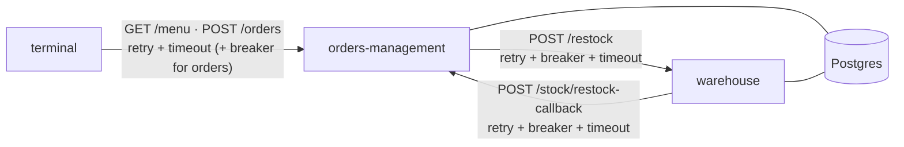
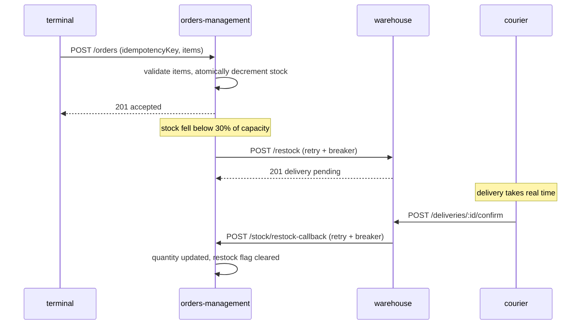

# Dogged

A resilient multi-service system built on a hot dog vendor domain. Three NestJS services talk to each other over real HTTP inside Docker, and each call is protected by the stability patterns from Michael Nygard's *Release It!*: timeouts, retry with exponential backoff and jitter, circuit breakers, idempotency, and fallbacks. You can break the services on purpose with built-in fault injection and watch the patterns react.

*Dogged*, as in persistent: it keeps going when its dependencies don't.

## Contents

- [Architecture](#architecture)
- [Resilience patterns](#resilience-patterns)
- [Running it](#running-it)
- [See it work: a chaos walkthrough](#see-it-work-a-chaos-walkthrough)
- [Testing](#testing)
- [Known limitations](#known-limitations)

## Architecture

| Service | Role | Storage |
|---|---|---|
| `terminal` (`:3000`) | The vendor's cart. Serves the menu and takes orders, calling `orders-management`. In a real system this would be client. | SQLite file (local menu cache) |
| `orders-management` (`:3001`) | The shared backend: menu catalog, idempotent orders, per-terminal stock, restock requests. | Postgres `orders_management` |
| `warehouse` (`:3002`) | Fulfils restock requests (stock is treated as infinite) and tracks deliveries. | Postgres `warehouse` |

Shared code lives in two libraries: `libs/resilience` (retry, breaker and timeout policies built on [cockatiel](https://github.com/connor4312/cockatiel)) and `libs/chaos` (fault injection).



### Network topology

Two Docker networks enforce the topology at the infrastructure level, not just in application code:

- `edge-net`: `terminal` and `orders-management`
- `backend-net`: `orders-management`, `warehouse` and `postgres`

`terminal` is not attached to `backend-net`, so it cannot even resolve the names `warehouse` or `postgres`. `orders-management` sits on both networks and is the only path between them.

### A restock, end to end



## Resilience patterns

Every cross-service call goes through a shared policy from `libs/resilience`. Policies stack as **retry (outer) → circuit breaker → timeout (inner)**, applied per attempt.

| Call | Policy | When it fails |
|---|---|---|
| `terminal` → `GET /menu` | 2s timeout, 3 retries with jittered exponential backoff (scale 500ms) | Falls back to the last good menu in a local SQLite cache, then to a built-in default menu. A background loop keeps retrying and refreshes the cache once the backend returns. |
| `terminal` → `POST /orders` | Same, scale 1000ms, plus a circuit breaker (opens after 3 consecutive failures, probes again after 30s) | Returns `503`. There is deliberately no fallback: an order can't be faked. |
| `orders-management` → `POST /restock` | Retry + breaker + timeout, fire-and-forget | Logged, and the "restock pending" claim is released so the next low-stock check can try again. The customer's order is never affected. |
| `warehouse` → `POST /stock/restock-callback` | Retry + breaker + timeout, fire-and-forget | Logged. The delivery stays recorded with `notifiedOrdersManagement: false`, visible via `GET /deliveries`. |

Details that make the policies behave correctly:

- **Only retryable errors are retried.** A `4xx` means the server rejected this specific request and would reject it again, so it is passed straight through to the caller and doesn't count against the breaker. Network errors, timeouts and `5xx` are retried (`isRetryableHttpError`).
- **An open breaker fails fast.** Retry sits outside the breaker, so it would otherwise treat the breaker's instant rejection as retryable and sleep through its whole backoff schedule. It explicitly refuses to retry a broken circuit, so rejections take milliseconds.
- **Backoff is tunable per call site** (`initialDelayMs`, `maxDelayMs`). Jitter spreads retries out so clients don't retry in lockstep.
- **Idempotency.** The caller supplies an `idempotencyKey` (UUID) that is carried through every layer and used as the order's primary key, so a retried request returns the original order instead of creating a duplicate. A concurrent duplicate that loses the insert race is caught (Postgres unique violation) and resolved to the existing order.
- **Graceful degradation.** If a terminal doesn't have enough stock, the order is still accepted and the response carries an `inventoryWarning`.

## Running it

```bash
cp .env.example .env
docker compose up --build
```

Migrations run automatically on boot and seed the menu plus stock for the terminals listed in `KNOWN_TERMINAL_IDS`.

- Terminal: http://localhost:3000/docs
- Orders Management: http://localhost:3001/docs
- Warehouse: http://localhost:3002/docs

Every service exposes Swagger at `/docs`. An importable Postman collection is in [`postman/dogged.postman_collection.json`](postman/dogged.postman_collection.json) (it uses `{{$guid}}` for idempotency keys).

### Without Docker

```bash
npm install
npm run start:terminal:dev
npm run start:orders-management:dev   # needs Postgres
npm run start:warehouse:dev           # needs Postgres
```

Outside Docker, override `POSTGRES_HOST=localhost` and point `ORDERS_MANAGEMENT_URL` / `WAREHOUSE_URL` at `http://localhost:<port>`.

## See it work: a chaos walkthrough

`orders-management` and `warehouse` each expose `POST /admin/chaos`, which makes their business endpoints fail or slow down on demand. The chaos endpoint itself and the health checks are never affected.

```bash
# 1. Make orders-management fail every request
curl -X POST localhost:3001/admin/chaos -H 'Content-Type: application/json' \
  -d '{"enabled":true,"mode":"error","failureRate":1}'

# 2. The menu degrades gracefully: served from the local cache after retries
curl localhost:3000/menu                 # "source": "cache"

# 3. Orders fail after retries; the breaker then opens...
curl -X POST localhost:3000/orders -H 'Content-Type: application/json' \
  -d '{"idempotencyKey":"'$(uuidgen)'","items":[{"name":"Hot Dog","quantity":1}]}'   # 503 after a few seconds

# 4. ...and further orders are rejected in milliseconds, not seconds
# 5. Turn chaos off; after the 30s half-open window the breaker closes again
curl -X POST localhost:3001/admin/chaos -H 'Content-Type: application/json' -d '{"enabled":false}'
```

Modes: `error` (fails a `failureRate` fraction of requests with `503`) and `delay` (adds `delayMs` to every request, to exercise timeouts).

## Testing

```bash
npm test          # unit tests (vitest)
npm run lint      # oxlint
npm run build:all
```

Specs that exercise the real retry and breaker policies use fake timers, so the suite runs in a couple of seconds despite multi-second backoffs.

## Known limitations

- **Resilience state is per instance.** Breaker state and chaos settings are in memory, so with several replicas each one has its own.
- **No reconciliation job.** If a delivery's callback to `orders-management` ultimately fails, it is logged and flagged (`notifiedOrdersManagement: false`) but not retried later.
- **One terminal service in Compose.** The data model supports several terminals (`KNOWN_TERMINAL_IDS`), but `docker-compose.yml` runs a single one.
- **The generated e2e specs are placeholders** and are not part of the passing suite.
